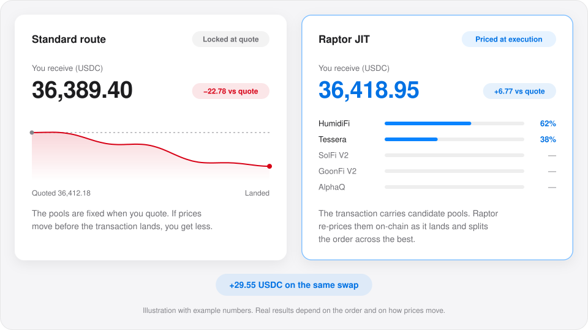
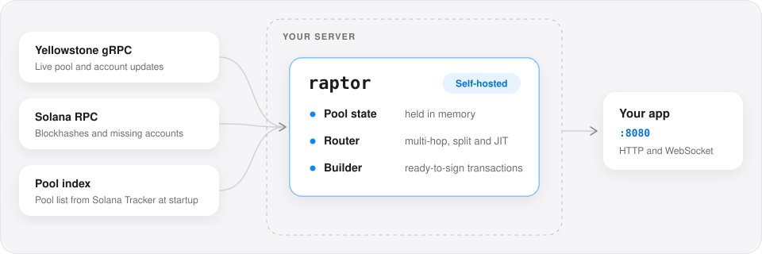
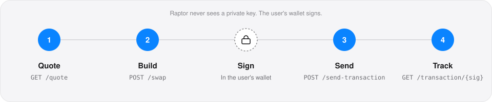

<div align="center">

# Raptor

### The self-hosted Solana swap API

Best-price routing across 71 DEXes, with on-chain JIT routing. Free to run, with no API key and no request limits.

[](https://github.com/solanatracker/raptor-binary/releases/latest)
[](https://docs.solanatracker.io/raptor/overview)
[](#pricing)
[](https://solana.com)
[](https://discord.gg/JH2e9rR9fc)

**[Download](https://github.com/solanatracker/raptor-binary/releases/latest)** · [Quickstart](#quickstart) · [Docs](https://docs.solanatracker.io/raptor/self-hosting) · [API reference](https://docs.solanatracker.io/raptor/overview) · [Discord](https://discord.gg/JH2e9rR9fc)

</div>

<br>

Raptor is a Solana DEX aggregator that runs on your own servers. Give it a token pair and an amount: it finds the best route across 71 DEXes and returns a transaction for the user's wallet to sign.

It's the same engine and the same HTTP and WebSocket API as the hosted service at [`raptor.solanatracker.io`](https://docs.solanatracker.io/raptor/overview), so code written for one works with the other.

| | |
| --- | --- |
| **Free** | The binary is free to download and run. The hosted API is free too. |
| **No key, no limits** | No API key, no sign-up and no request cap. Run as many instances as you like, and resell access if you want. |
| **Fast and light on RPC** | Pool state streams in over Yellowstone gRPC and stays in memory, so quotes never wait on RPC calls. |
| **JIT routing** | The transaction re-prices its candidate pools on-chain as it executes, and splits the order across the best of them. |
| **One on-chain program** | Every instance builds transactions for the same Raptor program, `RaptorD5ojtsqDDtJeRsunPLg6GvLYNnwKJWxYE4m87`. |

## JIT routing

A normal aggregator picks its pools when you ask for a quote. By the time the transaction lands, a few hundred milliseconds later, prices have moved, and the route it chose may no longer be the best.

With just-in-time (JIT) routing, the transaction carries several candidate pools instead of one fixed route. When it executes, the Raptor program re-prices every candidate on-chain and splits the order across the best of them. Price moves between quote and landing work for you instead of against you.

<picture>
  <source media="(prefers-color-scheme: dark)" srcset="assets/jit-routing-dark.svg">
  
</picture>

- **Always protected.** `minAmountOut` is enforced on-chain, the same as on a normal route. JIT can improve the result; it never takes it below your slippage limit.
- **On by default.** `jitRouting=auto` uses JIT when it's expected to beat the fixed route, and falls back to a normal route otherwise. Set `jitRouting=true` to force it, or `false` to turn it off.
- **Nearly every DEX.** JIT works on every supported DEX except Heaven, SolFi V1, BisonFi and Quantum.
- **`V0` and `V1` transactions.** `LEGACY` transactions can't use lookup tables and are limited to 1,232 bytes, so JIT routes rarely fit. Quote with `jitRouting=false` if you need `LEGACY`.

More in the [JIT routing docs](https://docs.solanatracker.io/raptor/overview#jit-routing).

## How it runs

<picture>
  <source media="(prefers-color-scheme: dark)" srcset="assets/self-host-dark.svg">
  
</picture>

On startup, Raptor downloads the current pool index from Solana Tracker. After that, Yellowstone gRPC keeps every pool up to date in memory. RPC is only used for blockhashes and the occasional account Raptor hasn't seen yet.

## Requirements

- **Linux** x86-64 with glibc 2.30+ (Ubuntu 20.04+, Debian 11+, RHEL 9+), or **macOS** on Apple Silicon or Intel.
- **A Solana RPC endpoint**, set as `RPC_URL`.
- **A Yellowstone gRPC endpoint**, set as `YELLOWSTONE_ENDPOINT`, plus `YELLOWSTONE_TOKEN` if your provider needs one. Raptor won't start without it.
- **A writable directory** for the pool cache. By default it's `.r_cache` next to the binary. Set `RAPTOR_POOL_DATA_DIR` to change it.
- **Outbound HTTPS**, to download the pool index on startup.

## Quickstart

### 1. Download and verify

Each [release](https://github.com/solanatracker/raptor-binary/releases/latest) has one zip per platform, named `raptor-<version>-<platform>.zip`, and a `checksums.txt`.

| Server | Platform |
| --- | --- |
| Linux, x86-64 | `x86_64-unknown-linux-gnu` |
| macOS, Apple Silicon | `aarch64-apple-darwin` |
| macOS, Intel | `x86_64-apple-darwin` |

```bash
VERSION=$(curl -s https://api.github.com/repos/solanatracker/raptor-binary/releases/latest \
  | grep -o '"tag_name": *"[^"]*"' | cut -d'"' -f4)
PLATFORM=x86_64-unknown-linux-gnu   # or aarch64-apple-darwin / x86_64-apple-darwin
BASE=https://github.com/solanatracker/raptor-binary/releases/download/$VERSION

curl -LO "$BASE/raptor-$VERSION-$PLATFORM.zip"
curl -LO "$BASE/checksums.txt"
sha256sum --check --ignore-missing checksums.txt   # macOS: shasum -a 256 --check --ignore-missing checksums.txt
unzip "raptor-$VERSION-$PLATFORM.zip"
```

The check prints `...zip: OK`. Keep `raptor.sig` in the same directory as `raptor`: the binary uses it to check that it hasn't been modified. If macOS blocks the binary, run `xattr -d com.apple.quarantine raptor`.

### 2. Run

```bash
export RPC_URL="https://your-rpc.example.com"
export YELLOWSTONE_ENDPOINT="https://your-grpc.example.com"
export YELLOWSTONE_TOKEN="your-token"   # if your provider needs one

./raptor
```

Raptor listens on `0.0.0.0:8080`. Set `BIND_ADDR` to change it. To turn on every optional feature:

```bash
./raptor --enable-websocket --enable-yellowstone-jet --enable-quote-and-swap
```

### 3. Wait until it's ready

```bash
curl http://localhost:8080/ready
```

`/ready` returns `200` once the pool index has loaded. Until then, `/quote` returns `503 Server warming up`.

### 4. Get a quote

Sell 0.1 SOL for USDC. Quotes don't need a wallet.

```bash
curl "http://localhost:8080/quote?inputMint=So11111111111111111111111111111111111111112&outputMint=EPjFWdd5AufqSSqeM2qN1xzybapC8G4wEGGkZwyTDt1v&amount=100000000&slippageBps=50"
```

Every example in the [API docs](https://docs.solanatracker.io/raptor/overview) works against your instance once you replace `https://raptor.solanatracker.io` with your server's address.

## Make a swap

<picture>
  <source media="(prefers-color-scheme: dark)" srcset="assets/swap-flow-dark.svg">
  
</picture>

```javascript
import { VersionedTransaction } from "@solana/web3.js";

const RAPTOR = "http://localhost:8080";

// 1. Quote 0.1 SOL -> USDC
const quote = await fetch(
  `${RAPTOR}/quote?inputMint=So11111111111111111111111111111111111111112` +
    `&outputMint=EPjFWdd5AufqSSqeM2qN1xzybapC8G4wEGGkZwyTDt1v&amount=100000000&slippageBps=50`
).then((r) => r.json());

// 2. Build the transaction right away (quotes expire after a few seconds). Send the quote unchanged.
const { swapTransaction } = await fetch(`${RAPTOR}/swap`, {
  method: "POST",
  headers: { "Content-Type": "application/json" },
  body: JSON.stringify({ quoteResponse: quote, userPublicKey: wallet.publicKey.toBase58(), priorityFee: "auto" }),
}).then((r) => r.json());

// Sign in the user's wallet
const tx = VersionedTransaction.deserialize(Buffer.from(swapTransaction, "base64"));
tx.sign([wallet]);

// 3. Send (needs --enable-yellowstone-jet)
const { signature } = await fetch(`${RAPTOR}/send-transaction`, {
  method: "POST",
  headers: { "Content-Type": "application/json" },
  body: JSON.stringify({ transaction: Buffer.from(tx.serialize()).toString("base64") }),
}).then((r) => r.json());

// 4. Track
const status = await fetch(`${RAPTOR}/transaction/${signature}`).then((r) => r.json());
```

You can also send the signed transaction through your own RPC. The [quickstart](https://docs.solanatracker.io/raptor/overview#quickstart) has a Python version and the full request and response formats.

### Common parameters

| Parameter | On | What it does |
| --- | --- | --- |
| `slippageBps` | `/quote` | Most the price may move against you, in basis points, or `dynamic` |
| `dexes`, `pools`, `maxHops`, `onlyDirectRoutes` | `/quote` | Limit the route for this request |
| `searchMode=deep` | `/quote` | Search more pools and routes, for the best price on large orders |
| `jitRouting` | `/quote` | `auto` (default), `true` or `false` |
| `feeAccount`, `feeBps` | `/quote` | Charge your own platform fee, up to 10% |
| `priorityFee` | `/swap` | `min`, `low`, `medium`, `auto`, `high`, `veryHigh`, `turbo`, `unsafeMax`, or lamports |
| `tipAccount`, `tipLamports` | `/swap` | Add a SOL tip, for example to Jito |
| `txVersion` | `/swap` | `V0` (default), `V1` or `LEGACY`. JIT works with `V0` and `V1` |

## Features

| Feature | Endpoints | Turned on by |
| --- | --- | --- |
| Quotes with multi-hop, split and JIT routing | `GET /quote` | Always on |
| Swap transactions, with priority fees, tips and platform fees | `POST /swap`, `POST /swap-instructions` | Always on |
| Health and readiness checks | `GET /health`, `GET /ready` | Always on |
| Live quote streaming | `/stream`, `/stream/swap` | `--enable-websocket` |
| Send transactions to block leaders and track them | `POST /send-transaction`, `GET /transaction/{signature}` | `--enable-yellowstone-jet` |
| Quote and build in one call | `POST /quote-and-swap` | `--enable-quote-and-swap` |
| Arbitrage quotes (same input and output mint) | `GET /quote` | `--enable-arbitrage` |

A request to a feature that's turned off returns `404`. Every flag also has an environment variable; for on/off variables, `1`, `true`, `yes` and `on` all turn the feature on.

<details>
<summary><b>WebSocket streaming</b></summary>

<br>

```bash
./raptor --enable-websocket      # or ENABLE_WEBSOCKET=true
```

Connect to `ws://your-server:8080/stream` for live quotes, or `/stream/swap` for quotes with a ready-to-sign transaction. Raptor pushes an update whenever the best route changes.

```javascript
const ws = new WebSocket("ws://localhost:8080/stream");
ws.onopen = () =>
  ws.send(JSON.stringify({
    type: "subscribe",
    inputMint: "So11111111111111111111111111111111111111112",
    outputMint: "EPjFWdd5AufqSSqeM2qN1xzybapC8G4wEGGkZwyTDt1v",
    amount: 100000000,
    slippageBps: "50",
  }));
ws.onmessage = (event) => {
  const msg = JSON.parse(event.data);
  if (msg.type === "quote") console.log(msg.data.amountOut, "at slot", msg.data.contextSlot);
};
```

</details>

<details>
<summary><b>Send and track transactions</b></summary>

<br>

```bash
./raptor --enable-yellowstone-jet      # or ENABLE_YELLOWSTONE_JET=true
```

Raptor sends signed transactions straight to the upcoming block leaders over QUIC with [Yellowstone Jet](https://github.com/rpcpool/yellowstone-jet), and resends them until they land or expire. The server needs outbound UDP to Solana validators.

| Flag | Variable | Default | What it does |
| --- | --- | --- | --- |
| `--jet-identity <PATH>` | `JET_IDENTITY` | none | Keypair to send from. A staked validator identity gets stake-weighted priority. |
| `--jet-identities <N>` | `JET_NUM_IDENTITIES` | `4` | Without `--jet-identity`, send from this many random identities |
| `--tx-cache-ttl <SECS>` | `TX_CACHE_TTL_SECS` | `30` | How long a finished transaction stays queryable |
| `--tx-pending-expiry <SECS>` | `TX_PENDING_EXPIRY_SECS` | `120` | When an unlanded transaction is marked `expired` |

`GET /transaction/{signature}` returns `pending`, `confirmed`, `failed` or `expired`, with the parsed swap amounts once it lands.

</details>

<details>
<summary><b>Quote and swap in one call</b></summary>

<br>

```bash
./raptor --enable-quote-and-swap      # or -s, or ENABLE_QUOTE_AND_SWAP=true
```

`POST /quote-and-swap` quotes and builds the transaction in one request, saving a round trip for bots and backends.

</details>

<details>
<summary><b>Arbitrage</b></summary>

<br>

```bash
./raptor --enable-arbitrage      # or ENABLE_ARBITRAGE=true
```

`/quote` then accepts the same mint as input and output, for example SOL to SOL, and looks for a cycle through several pools that returns more than you put in. An empty `routePlan` means no profitable cycle was found. Without the flag, same-mint quotes return `400`.

</details>

## Production

### Limit what Raptor routes

These filters apply to the whole instance. DEX filters also cut what Raptor streams from Yellowstone, which saves memory and bandwidth.

| Flag | Variable | What it does |
| --- | --- | --- |
| `--include-dexes <DEXES>` | `INCLUDE_DEXES` | Use only these DEXes, comma-separated |
| `--exclude-dexes <DEXES>` | `EXCLUDE_DEXES` | Use every DEX except these |
| `--include-mints-file <PATH>` | `INCLUDE_MINTS_FILE` | Use only pools that hold a mint from this file |
| `--include-pools-file <PATH>` | `INCLUDE_POOLS_FILE` | Use only the pools in this file |

```bash
./raptor --include-dexes raydium,meteora,whirlpool,pumpswap
```

DEX names are case-insensitive: `raydium-clmm`, `raydium_clmm` and `"Raydium CLMM"` are the same DEX, and `raydium` matches every Raydium pool type. Allowlist files have one address per line; `#` starts a comment.

### Run several instances

Each instance runs independently with its own Yellowstone stream, so you can put as many as you need behind a load balancer. If a client's `/quote` and `/swap` can reach different instances, give every instance the same secret so they accept each other's quotes:

```bash
export RAPTOR_QUOTE_SECRET="$(openssl rand -hex 32)"   # same value on every instance; keep it private
```

On small servers, `--low-memory` keeps bonding-curve pools on disk instead of in memory.

### Run it as a service

```ini
# /etc/systemd/system/raptor.service
[Unit]
Description=Raptor swap API
After=network-online.target
Wants=network-online.target

[Service]
WorkingDirectory=/opt/raptor
ExecStart=/opt/raptor/raptor --enable-websocket --enable-yellowstone-jet
EnvironmentFile=/etc/raptor.env
Restart=always
RestartSec=5
LimitNOFILE=1048576

[Install]
WantedBy=multi-user.target
```

```bash
# /etc/raptor.env
RPC_URL=https://your-rpc.example.com
YELLOWSTONE_ENDPOINT=https://your-grpc.example.com
YELLOWSTONE_TOKEN=your-token
```

```bash
sudo systemctl daemon-reload && sudo systemctl enable --now raptor
journalctl -u raptor -f
```

Docker instructions are in the [self-hosting guide](https://docs.solanatracker.io/raptor/self-hosting#run-it-as-a-service).

**Updating:** download the new release, replace `raptor` and `raptor.sig`, and restart. Keep the pool cache directory between versions.

## Configuration reference

Flags take their value either way: `--workers 8` or `--workers=8`.

| Flag | Variable | Default | Description |
| --- | --- | --- | --- |
| | `RPC_URL` | required | Solana RPC endpoint |
| | `YELLOWSTONE_ENDPOINT` | required | Yellowstone gRPC endpoint |
| | `YELLOWSTONE_TOKEN` | none | Yellowstone auth token |
| | `BIND_ADDR` | `0.0.0.0:8080` | Address and port to listen on |
| | `RAPTOR_QUOTE_SECRET` | none | Shared secret (32+ characters) so instances accept each other's quotes |
| | `RAPTOR_POOL_DATA_DIR` | `.r_cache` beside the binary | Pool cache directory |
| `--enable-websocket` | `ENABLE_WEBSOCKET` | off | Serve `/stream` and `/stream/swap` |
| `--enable-yellowstone-jet` | `ENABLE_YELLOWSTONE_JET` | off | Serve `/send-transaction` and `/transaction/{signature}` |
| `-s`, `--enable-quote-and-swap` | `ENABLE_QUOTE_AND_SWAP` | off | Serve `/quote-and-swap` |
| `--enable-arbitrage` | `ENABLE_ARBITRAGE` | off | Allow same-mint arbitrage quotes |
| `--include-dexes <DEXES>` | `INCLUDE_DEXES` | all | Use only these DEXes |
| `--exclude-dexes <DEXES>` | `EXCLUDE_DEXES` | none | Never use these DEXes |
| `--include-mints-file <PATH>` | `INCLUDE_MINTS_FILE` | none | Use only pools holding a listed mint |
| `--include-pools-file <PATH>` | `INCLUDE_POOLS_FILE` | none | Use only the listed pools |
| `--jet-identity <PATH>` | `JET_IDENTITY` | none | Keypair to send transactions from |
| `--jet-identities <N>` | `JET_NUM_IDENTITIES` | `4` | Random sending identities when no keypair is set |
| `--tx-cache-ttl <SECS>` | `TX_CACHE_TTL_SECS` | `30` | How long sent transactions stay queryable |
| `--tx-pending-expiry <SECS>` | `TX_PENDING_EXPIRY_SECS` | `120` | When a pending transaction is marked `expired` |
| `--workers <N>` | `WORKER_THREADS` | CPU cores | Worker threads |
| `--low-memory` | `LOW_MEMORY_MODE` | off | Bounded caches and on-disk bonding-curve pools |
| `--memory-limit <MB>` | `MEMORY_LIMIT_MB` | 80% of RAM | Memory budget for low-memory mode |
| `--rpc-rate-limit <N>` | `RPC_RATE_LIMIT` | unlimited | Most RPC requests per second |
| | `RAPTOR_MAX_INFLIGHT` | `2048` | Requests in flight across all clients before Raptor answers 429 (`0` = unlimited) |
| | `RAPTOR_MAX_INFLIGHT_PER_IP` | `256` | Requests in flight per client address (`0` = unlimited; raise it behind a proxy) |
| | `RAPTOR_MAX_SEND_TASKS` | `512` | Transactions being resent at once by `/send-transaction` |
| | `RAPTOR_SERVER_TIMING` | off | Add per-stage `Server-Timing` headers to `/quote` responses |
| `--skip-pool-indexer-wait` | `SKIP_POOL_INDEXER_WAIT` | off | Serve before the pool index has synced |
| `--no-pool-indexer` | `NO_POOL_INDEXER` | off | Find pools from Yellowstone only (much slower to cover every pool) |
| `-h`, `--help` | | | Show help |
| `-v`, `--version` | | | Show the version |

## Supported DEXes

Raptor routes across 71 DEXes. JIT routing works on all of them except Heaven, SolFi V1, BisonFi and Quantum.

| Group | DEXes |
| --- | --- |
| Raydium | AMM, CLMM, CPMM, LaunchLab |
| Meteora | DLMM, Dynamic AMM, DAMM V2, Curve, Dynamic Bonding Curve |
| Orca | Whirlpool, Whirlpool V2 |
| Launchpads | Pump.fun, Pumpswap, Heaven, MoonIt, Boopfun |
| PropAMMs | HumidiFi, Tessera, SolFi V1, SolFi V2, AlphaQ, ZeroFi, BisonFi, GoonFi V2 |
| Other | FluxBeam, PancakeSwap V3 |
| More | Aquifer, Archer, BinaryFi, BisonFi Predict, BonkSwap, Crema, Cropper, Denali, Deriverse, Flint, Fusion, GatorSwap, Hadron, Helium, Huma, Hylo Earn, Hylo Exchange, Invariant, JupLend, JupLend Earn, Kipseli, Kipseli V3, M Swap, Mercurial, MetaDAO, Omnipair, OneDex, Perena, Perena Star, Quantum, Quay, Riptide, Sanctum Infinity, Sanctum PAMM, Sanctum SOLs, Sanctum Stake, Scale AMM, Scorch, Solayer, Stabble CLMM, Stableswap, TaurusFi, Trends, VaultLiquid, Voltr, WhaleStreet V2, xORCA |

## Troubleshooting

| Symptom | Fix |
| --- | --- |
| Exits with `RPC_URL environment variable is required` | Set `RPC_URL` and `YELLOWSTONE_ENDPOINT` where Raptor runs. Under systemd, use the `EnvironmentFile`. |
| `/quote` returns `503 Server warming up` | Raptor is still loading pools. Wait for `/ready` to return `200`, and check the logs for Yellowstone errors. |
| `/stream`, `/send-transaction` or `/quote-and-swap` returns `404` | Turn the feature on with its flag. |
| `/swap` rejects a quote from another instance | Set the same `RAPTOR_QUOTE_SECRET` everywhere, or pin each client to one instance. |
| `GLIBC_2.30 not found` | Use Ubuntu 20.04+, Debian 11+ or newer, or run it in Docker. |
| Your RPC provider rate-limits Raptor | Set `--rpc-rate-limit` below your plan's limit. |

## Pricing

Both the binary and the [hosted API](https://docs.solanatracker.io/raptor/overview) are **currently free**, with no API key or sign-up.

## FAQ

<details>
<summary><b>Does the binary need an API key or a license?</b></summary>

<br>

No. Download it and run it. There's no key and no request limit.

</details>

<details>
<summary><b>Can I resell access to my instance?</b></summary>

<br>

Yes. Run it behind your own API, charge for access, and add your own platform fee with `feeAccount` and `feeBps`.

</details>

<details>
<summary><b>Is it an alternative to the Metis binary?</b></summary>

<br>

Yes. Raptor fills the same role: a self-hosted aggregator that quotes and builds swaps. It needs no binary key, you can run unlimited instances, and it adds on-chain JIT routing.

</details>

<details>
<summary><b>Does Raptor hold user funds or keys?</b></summary>

<br>

No. Raptor returns unsigned transactions, and the user's wallet signs them.

</details>

<details>
<summary><b>Is the source code available?</b></summary>

<br>

No. Raptor is closed source; this repository hosts the releases.

</details>

## Support

- **Docs:** [docs.solanatracker.io/raptor](https://docs.solanatracker.io/raptor/self-hosting)
- **Bugs and feature requests:** [open an issue](https://github.com/solanatracker/raptor-binary/issues)
- **Chat with the team:** [Discord](https://discord.gg/JH2e9rR9fc)

If Raptor is useful to you, a ⭐ helps others find it.

<br>

<div align="center">

Built by [Solana Tracker](https://www.solanatracker.io)

</div>
